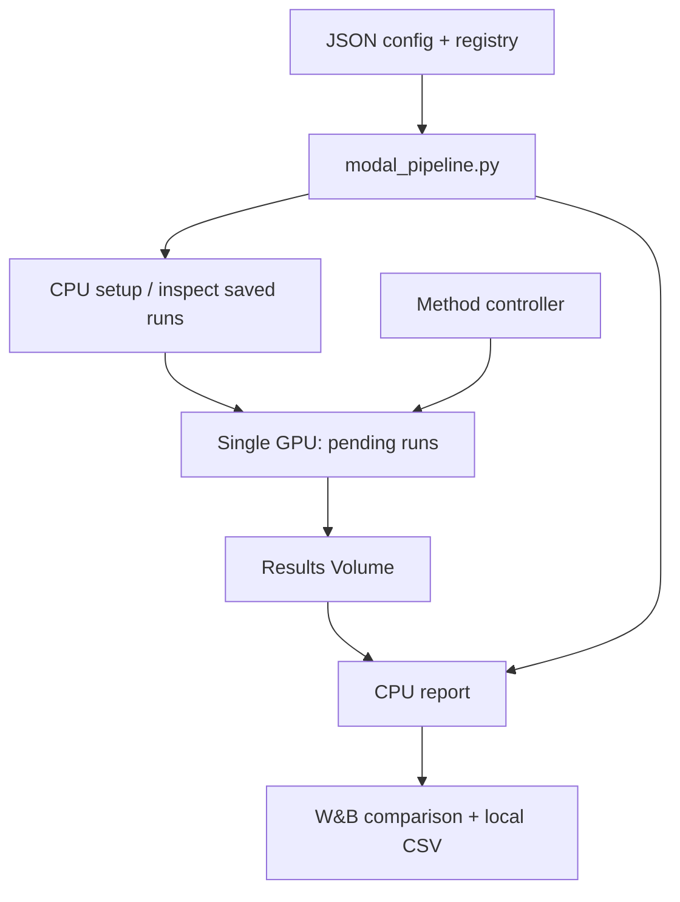

# Kiến trúc

| File / thư mục | Trách nhiệm |
|---|---|
| `config.py` | Merge mặc định, validate task/rank/protocol/method parameters |
| `registry.py` | Khám phá MethodSpec, aliases, labels và controller factory |
| `planning.py` | Cartesian product task/rank/method/seed; source hashes và run IDs |
| `methods/` | Metadata và phần toán học riêng của method |
| `pipeline/prepare.py` | Patch source upstream đã pin để gọi tracking/checkpoint/shared Trainer |
| `pipeline/worker.py` | CPU bootstrap, cache/provenance, subprocess train/eval, commit Volume |
| `pipeline/trainer.py` | CE accumulation + auxiliary một lần/update, AMP, lifecycle/checkpoint state |
| `pipeline/checkpointing.py` | Chỉ chọn checkpoint đầy đủ, đúng step và identity |
| `pipeline/tracking.py` | W&B training run, diagnostic sample và evaluation metrics |
| `pipeline/evaluate.py` | Gọi harness gốc với adapter cuối và split đã chọn |
| `reporting/collect.py` | Đọc cả v1/v2, kiểm tra comparability, đo norm từ weights |
| `reporting/wandb.py` | W&B Tables/charts, ID comparison ổn định |
| `reporting/service.py` | Auto-discovery experiment và xuất báo cáo |

Một optimizer update: forward/backward CE qua microbatch → auxiliary ISR một lần → AMP unscale → gradient clipping → AdamW → nếu fixed-norm thì rescale B → scheduler/log/save. Counter warm-up của ISR tính theo successful optimizer updates; AMP skip không chiếu B hoặc tăng counter thành công.

Baseline dùng Trainer và PEFT backend gốc; PoLAR giữ callback landing gốc. Chỉ controller methods dùng ResearchTrainer. Mã upstream được clone từ commit `7c9eeabe54cf94e2051632829019c86c4198b3df`; local copy của dependency không được tự động đưa vào image. Nếu sau này sửa PEFT backend local, phải chủ động thay bước build/source pin tương ứng.

V2 checkpoint có adapter, optimizer, scheduler, RNG, Trainer state, scaler khi FP16 và `method_state.pt` cho controller method. Marker `checkpoint_ready.json` được tạo sau các phần state và kèm run/source identity. Worker yêu cầu Volume commit khi checkpoint sẵn sàng.

Reporter nhận kết quả đủ test evaluation; sai model revision/dataset revision/seed/protocol sẽ được cảnh báo và không tính delta accuracy như một so sánh tương đương. Auto-discovery bỏ smoke; config `seeds` chọn seed cần hiển thị, không tự gộp nhiều seed thành mean±std.

W&B training run giữ loss/update logs. W&B comparison là run tổng hợp riêng chứa metric cuối và các norm theo layer; nó không biến final checkpoint thành một lịch sử norm theo thời gian.
